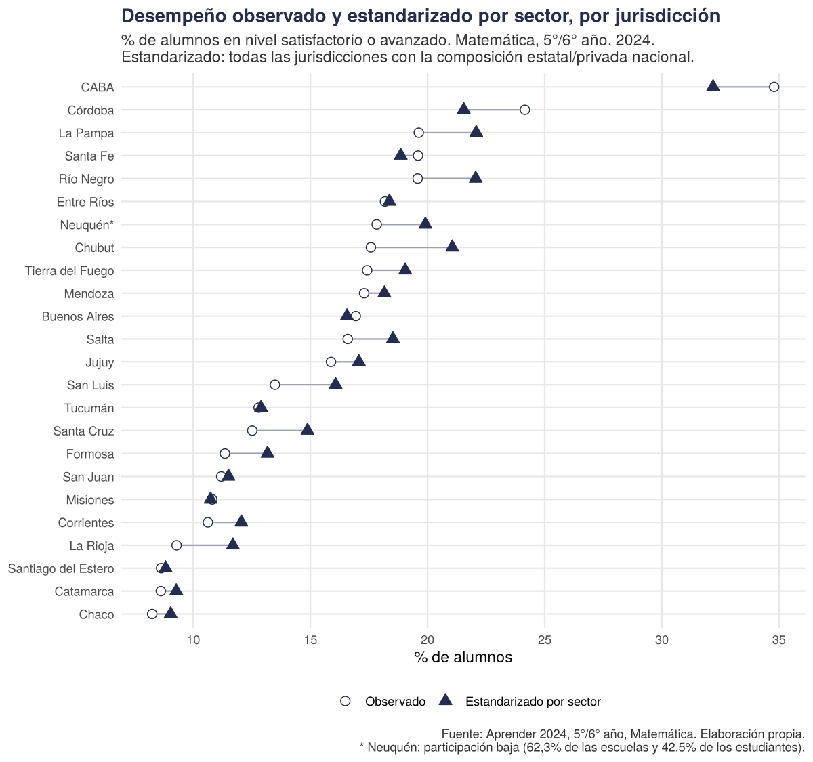

# Brechas por sector y ámbito en Matemática de 5°/6° año de secundaria y ranking estandarizado por sector (Aprender 2024)

> **Elaboración propia a partir de datos abiertos. No es una publicación oficial de la Secretaría de Educación de la Nación ni refleja su posición.**

> **Estado: análisis v0.x, en construcción.** Fases 0 a 5 completas (estructura, carga, auditoría, indicadores descriptivos, estandarización por sector e informe en Quarto). Informe publicado como página web: https://friedsam-r.github.io/aprender-2024-secundaria-brechas/reports/informe.html

## Pregunta

¿Cuánto del desempeño de cada jurisdicción en Matemática de 5°/6° año se relaciona con cuántos alumnos van a escuelas estatales o privadas? Si todas las jurisdicciones tuvieran la misma composición, ¿cambia el ranking?

Es un análisis **descriptivo**. Estandarizar por composición no aísla un efecto de gestión ni de política. Este proyecto repite el método de [aprender-2025-brechas](https://github.com/Friedsam-R/aprender-2025-brechas) (primaria) en otro nivel; **no compara niveles de desempeño entre ambos**.

## Resultado principal



Al estandarizar por la composición estatal y privada, el ranking de jurisdicciones cambia poco (correlación de Spearman de 0,96 entre el ranking observado y el estandarizado). El análisis completo, con su auditoría y sus limitaciones, está en [`reports/informe.html`](reports/informe.html).

## Datos

Aprender 2024, secundaria 5°/6° año, Matemática, base agregada por departamento, sector y ámbito, de los datos abiertos de la Subsecretaría de Información y Evaluación Educativa (Secretaría de Educación de la Nación). Los datos **no se incluyen en este repositorio**: las instrucciones de descarga están en [`data/README.md`](data/README.md).

## Método

Estandarización directa por sector (y, como análisis secundario, por sector y ámbito), con los pesos de la composición nacional. Todas las reglas se fijaron antes de calcular la estandarización y están en [`docs/diseno_proyecto_2.md`](docs/diseno_proyecto_2.md), junto con los controles de auditoría, la sensibilidad y las limitaciones.

## Estructura

```
├── README.md
├── data/
│   └── README.md            instrucciones de descarga (los datos no se suben)
├── docs/
│   ├── diseno_proyecto_2.md especificación del análisis
│   └── img/                 figura del README
├── R/                       scripts numerados, uno por fase (00_helpers.R es de uso común)
├── output/                  tablas y figuras generadas (no se suben)
└── reports/                 informe en Quarto (informe.qmd)
```

## Cómo reproducir

1. Descargar el CSV como indica [`data/README.md`](data/README.md) y guardarlo como `data/raw/aprender_2024_sec_mat.csv`.
2. Desde la raíz del proyecto, con una sesión de R en UTF-8:

```bash
Rscript R/01_carga.R
Rscript R/02_auditoria.R
Rscript R/03_indicadores.R
Rscript R/04_estandarizacion.R
quarto render reports/informe.qmd
```

Los scripts frenan con un error si alguna dimensión o control de auditoría no coincide con lo esperado. Las tablas y figuras quedan en `output/`. Probado con R 4.3.3 (readr 2.1.5, dplyr 1.1.4, tidyr 1.3.1, ggplot2 3.4.4) y con R 4.6.0 (dplyr 1.2.1, readr 2.2.0, knitr 1.51), con las mismas cifras de auditoría y de estandarización. Solo usa paquetes del tidyverse.

## Limitaciones

Ver la sección 7 de [`docs/diseno_proyecto_2.md`](docs/diseno_proyecto_2.md).

## Autor

Carlos Friedsam · [LinkedIn](https://www.linkedin.com/in/carlos-friedsam-93709513b/)

## Licencia

El código se distribuye bajo licencia MIT (ver [`LICENSE`](LICENSE)). Los datos de origen no se incluyen en este repositorio y se rigen por los términos de uso del portal de datos abiertos de la Secretaría de Educación de la Nación; conviene verificarlos antes de reutilizarlos.
